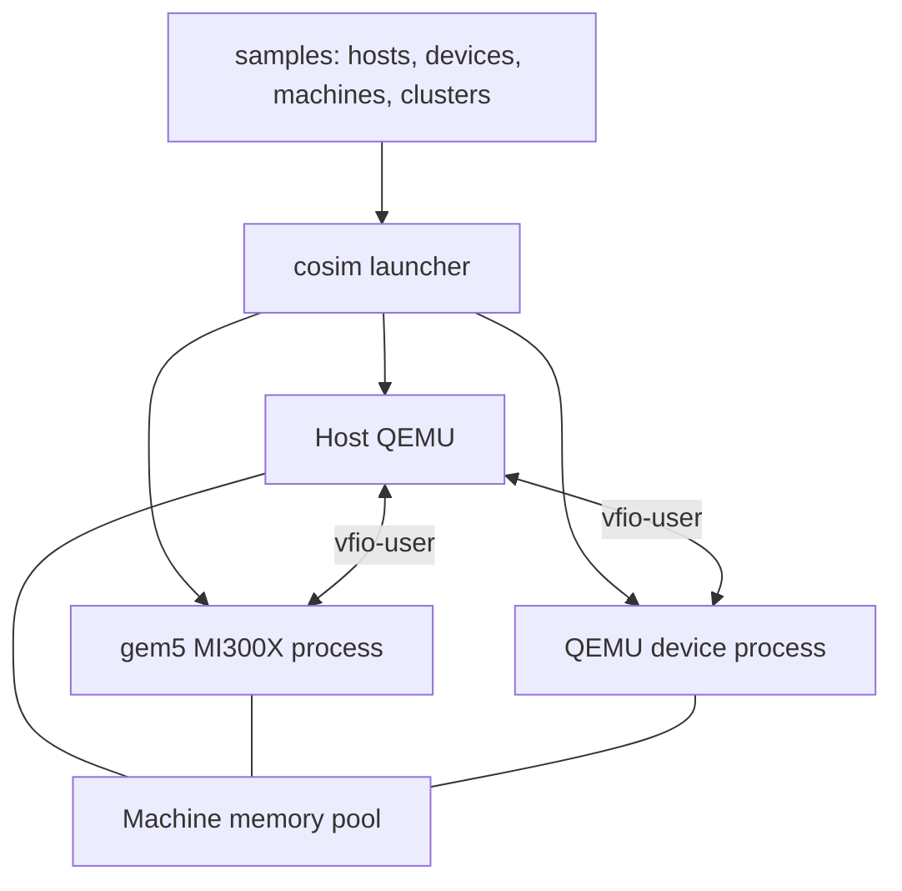

# cosim-gpu

[中文](README.zh.md)

Describe a QEMU machine and its simulated devices in YAML, then start the
environment with `cosim`. Device models run in **gem5** or **QEMU** as native
processes connected to the host through **vfio-user**. The MI300X model runs
AMD ROCm/HIP workloads inside a Linux guest.



Each machine has one host, its devices and one shared memory file. The Rust
launcher computes guest RAM and device-region offsets, prepares disk overlays,
starts devices before their host, stops the host before its devices, and
releases every resource it created. Device communication and simulator timing
are implemented by the device models.

## Start from a topology

```bash
just submodules
just dev-image        # outside Linux, or with COSIM_ENV=container

# Inspect configuration without starting simulators
just cosim validate samples/machines/gpu-8.yaml
just cosim plan samples/machines/mixed-models.yaml
just cosim graph samples/clusters/cluster-4x8.yaml

# Build the complete x86_64 Linux guest-image workflow and run it
just build-all
just run samples/machines/single-gpu.yaml
```

A machine can combine both device-model types:

```yaml
version: 1
imports:
  - hosts/qemu.yaml
  - hosts/ubuntu-24.yaml
  - devices/gpu/mi300x.yaml
  - devices/pci/qemu-edu.yaml
machines:
  - id: m0
    host: {use: ubuntu, memory: 32G}
    devices:
      - {use: mi300x, count: 2}
      - {use: qemu-edu}
```

The QEMU device example serves the real `edu` PCI model through
`x-vfio-user-server` from the QEMU built by `just build-qemu`.
[Topology and runtime](docs/en/topology.md) describes templates, imports,
storage, memory layouts, adapters and the session lifecycle.

## Environment

The recipes that build QEMU, gem5, m5 and `cosim`, run topologies and run the
Rust checks use `scripts/dev.sh`. They run natively on Linux when the
dependencies are installed. Other systems, or `COSIM_ENV=container`, run them
in a temporary development container from `scripts/Dockerfile.dev`. The source
tree is mounted at its host path, and the container is removed when the command
exits. The guest-image and HIP application builds and the shell launch
interface (`just launch`, `just test`) keep their own Docker and host
workflows.

- Rust launcher and configuration checks: Rust 1.95+, Cargo and just, or the
  development container.
- Sessions: Linux with glibc and `setpriv` (util-linux), QEMU for the host
  architecture and `qemu-img`.
- MI300X co-simulation: gem5 VEGA_X86, the QEMU submodule build with vfio-user
  support and the guest image inputs; KVM for the Ubuntu guest.
- QEMU device servers: QEMU built with `--enable-vfio-user-server`
  (`just build-qemu`).

Guest-image builds and simulator artifacts require sufficient disk space. The
memory-pool filesystem must accommodate the complete layout; the eight-GPU
sample declares a 96 GiB pool.

## Commands

- `just dev-image` builds the development container image; `just dev-shell`
  opens a shell in a temporary container.
- `just build-cosim` builds the release `cosim` executable.
- `just run <yaml>` launches a topology; `just run-dev <yaml>` uses the
  development build.
- `just cosim <command>` runs `validate`, `plan`, `graph`, `schema` or `clean`.
- `just build-qemu [jobs]` builds QEMU with KVM and vfio-user support.
- `just build-gem5 [jobs]` builds gem5; use one job for memory-constrained
  linking.
- `just build-disk` builds the Ubuntu/ROCm guest image.
- `just launch [options]` runs the shell-based QEMU/gem5 launch interface.
- `just test --all` runs guest GPU tests in fresh sessions.
- `just check-cosim` runs rustfmt, Clippy and the Rust tests.
- `just test-cosim-integration` runs sessions with real QEMU processes, disks
  and signals; `just test-cosim-vfio-user` adds a QEMU vfio-user device.

Host-only verification with an installed QEMU:

```bash
just run-dev samples/machines/host-only.yaml --run-for 1

# ARM64 hardware
just run-dev samples/machines/host-only-aarch64.yaml --run-for 1
```

ARM64 hosts use `qemu-system-aarch64`; x86_64 hosts use `qemu-system-x86_64`.
`COSIM_HOST_ARCH` selects the build architecture and defaults to the current
hardware. gem5 builds into `build/aarch64/VEGA_X86` on ARM64 and
`build/x86_64/VEGA_X86` on x86_64. The supplied Ubuntu/ROCm guest-image builder
targets x86_64.

The session directory contains the resolved plan, memory layouts, process logs
and `verdict.json`. Guest driver initialization is provided by
`cosim-gpu-setup.service` with:

```text
amdgpu ip_block_mask=0x67 ppfeaturemask=0 dpm=0 audio=0 ras_enable=0 discovery=2
```

## Source map

- `crates/cosim-topology/`: YAML documents, validated types, memory layouts
  and adapter rendering.
- `crates/cosim-runtime/`: plans, session resources, process supervision and
  cleanup.
- `crates/cosim-cli/`: the `cosim` command-line interface.
- `samples/`: host, device, machine and cluster configurations.
- `qemu/`: host QEMU and the QEMU device-server implementation.
- `gem5/`: MI300X model and vfio-user interface.
- `gem5-resources/`: guest image, kernel and GPU programs.
- `configs/sst/`: SST network topology descriptions and integration experiments.
- `scripts/`, `justfile`: build recipes, the development container and guest
  test utilities.
- `.agents/`: repository workflows.

## Documentation

- [Topology and runtime](docs/en/topology.md)
- [Rust guidelines](docs/en/guidelines.md)
- [Architecture](docs/en/architecture.md)
- [Getting started](docs/en/getting-started.md)
- [Reference](docs/en/reference.md)
- [Contributing](docs/en/contributing.md)

The top-level project uses the [Apache 2.0 license](LICENSE). Submodules retain
their respective licenses.
