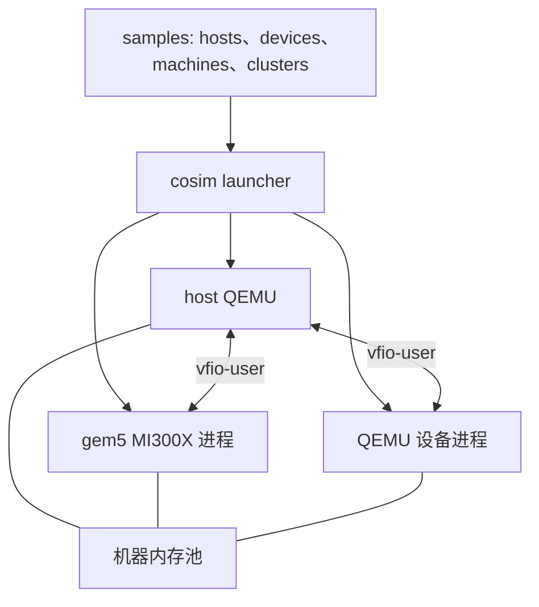

# cosim-gpu

[English](README.md)

用 YAML 描述 QEMU 机器及其模拟设备，再用 `cosim` 启动整个环境。设备模型运行在
**gem5** 或 **QEMU** 中，以原生进程的形式通过 **vfio-user** 连接到 host。MI300X 模型
可以在 Linux 客户机中运行 AMD ROCm/HIP 负载。



每台机器包含一个 host、它的设备和一个共享内存文件。Rust launcher 计算客户机内存
和设备区域的偏移，准备磁盘 overlay，先启动设备再启动 host，先停止 host 再停止设备，
并释放自己创建的全部资源。设备之间的通信和模拟器时序由设备模型实现。

## 从拓扑开始

```bash
just submodules
just dev-image        # 非 Linux 系统，或设置 COSIM_ENV=container 时

# 检查配置，不启动模拟器
just cosim validate samples/machines/gpu-8.yaml
just cosim plan samples/machines/mixed-models.yaml
just cosim graph samples/clusters/cluster-4x8.yaml

# 构建完整的 x86_64 Linux 客户机镜像流程并运行
just build-all
just run samples/machines/single-gpu.yaml
```

一台机器可以组合两类设备模型：

```yaml
version: 1
imports:
  - hosts/qemu.yaml
  - hosts/ubuntu-24.yaml
  - devices/gpu/mi300x.yaml
  - devices/pci/qemu-edu.yaml
machines:
  - id: m0
    host: {use: ubuntu, memory: 32G}
    devices:
      - {use: mi300x, count: 2}
      - {use: qemu-edu}
```

QEMU 设备示例使用 `just build-qemu` 构建的 QEMU，通过 `x-vfio-user-server` 提供真实的
`edu` PCI 模型。[拓扑与运行管理](docs/zh/topology.md)说明模板、导入、存储、内存布局、
适配器和会话生命周期。

## 运行环境

构建 QEMU、gem5、m5 和 `cosim`，运行拓扑，以及运行 Rust 检查的 recipe 通过
`scripts/dev.sh` 执行。依赖安装齐全时，这些 recipe 在 Linux 上原生运行。其他系统，
或者设置 `COSIM_ENV=container` 时，它们在基于 `scripts/Dockerfile.dev` 的临时开发
容器中运行。源码树按主机上的路径挂载，命令结束后容器随即删除。客户机镜像构建、
HIP 应用构建和 shell 启动接口（`just launch`、`just test`）继续使用各自的 Docker
和主机流程。

- Rust launcher 和配置检查：Rust 1.95+、Cargo 和 just，或者开发容器。
- 会话：使用 glibc 并带 `setpriv`（util-linux）的 Linux、对应主机架构的 QEMU 和
  `qemu-img`。
- MI300X 联合仿真：gem5 VEGA_X86、带 vfio-user 支持的 QEMU 子模块构建以及客户机
  镜像输入；Ubuntu 客户机需要 KVM。
- QEMU 设备服务端：使用 `--enable-vfio-user-server` 构建的 QEMU（`just build-qemu`）。

客户机镜像构建和模拟器产物需要足够的磁盘空间。内存池所在的文件系统必须容纳完整
布局，8 GPU 示例声明了 96 GiB 的内存池。

## 命令

- `just dev-image` 构建开发容器镜像；`just dev-shell` 在临时容器中打开 shell。
- `just build-cosim` 构建 release 版本的 `cosim`。
- `just run <yaml>` 启动拓扑；`just run-dev <yaml>` 使用开发构建。
- `just cosim <command>` 运行 `validate`、`plan`、`graph`、`schema` 或 `clean`。
- `just build-qemu [jobs]` 构建支持 KVM 和 vfio-user 的 QEMU。
- `just build-gem5 [jobs]` 构建 gem5；内存不足时链接阶段使用一个任务。
- `just build-disk` 构建 Ubuntu/ROCm 客户机镜像。
- `just launch [options]` 运行基于 shell 的 QEMU/gem5 启动接口。
- `just test --all` 在新的会话中运行客户机 GPU 测试。
- `just check-cosim` 运行 rustfmt、Clippy 和 Rust 测试。
- `just test-cosim-integration` 使用真实 QEMU 进程、磁盘和信号运行会话；
  `just test-cosim-vfio-user` 额外加入 QEMU vfio-user 设备。

使用已安装的 QEMU 进行仅含 host 的验证：

```bash
just run-dev samples/machines/host-only.yaml --run-for 1

# ARM64 硬件
just run-dev samples/machines/host-only-aarch64.yaml --run-for 1
```

ARM64 host 使用 `qemu-system-aarch64`，x86_64 host 使用 `qemu-system-x86_64`。
`COSIM_HOST_ARCH` 选择构建架构，默认使用当前硬件架构。gem5 在 ARM64 上构建到
`build/aarch64/VEGA_X86`，在 x86_64 上构建到 `build/x86_64/VEGA_X86`。提供的
Ubuntu/ROCm 客户机镜像构建流程面向 x86_64。

会话目录包含解析后的执行计划、内存布局、进程日志和 `verdict.json`。客户机驱动由
`cosim-gpu-setup.service` 初始化，参数为：

```text
amdgpu ip_block_mask=0x67 ppfeaturemask=0 dpm=0 audio=0 ras_enable=0 discovery=2
```

## 源码结构

- `crates/cosim-topology/`：YAML 文档、校验后的类型、内存布局和适配器渲染。
- `crates/cosim-runtime/`：执行计划、会话资源、进程监督和清理。
- `crates/cosim-cli/`：`cosim` 命令行接口。
- `samples/`：host、设备、机器和集群配置。
- `qemu/`：host QEMU 和 QEMU 设备服务端实现。
- `gem5/`：MI300X 模型和 vfio-user 接口。
- `gem5-resources/`：客户机镜像、内核和 GPU 程序。
- `configs/sst/`：SST 网络拓扑描述和集成实验。
- `scripts/`、`justfile`：构建 recipe、开发容器和客户机测试工具。
- `.agents/`：仓库工作流。

## 文档

- [拓扑与运行管理](docs/zh/topology.md)
- [Rust 开发规范](docs/zh/guidelines.md)
- [架构](docs/zh/architecture.md)
- [快速入门](docs/zh/getting-started.md)
- [参考手册](docs/zh/reference.md)
- [贡献指南](docs/zh/contributing.md)

顶层项目使用 [Apache 2.0 许可证](LICENSE)。子模块保留各自的许可证。
