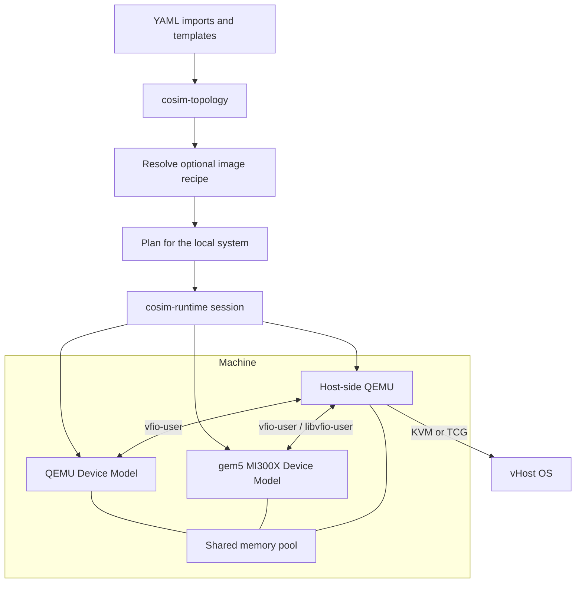
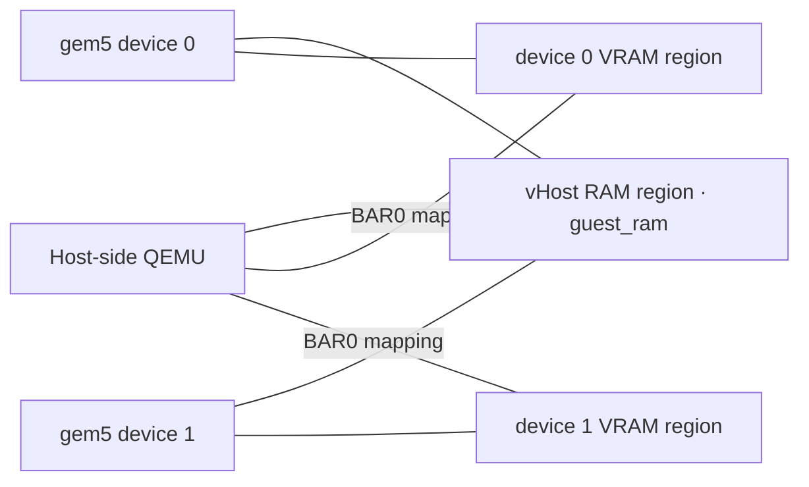
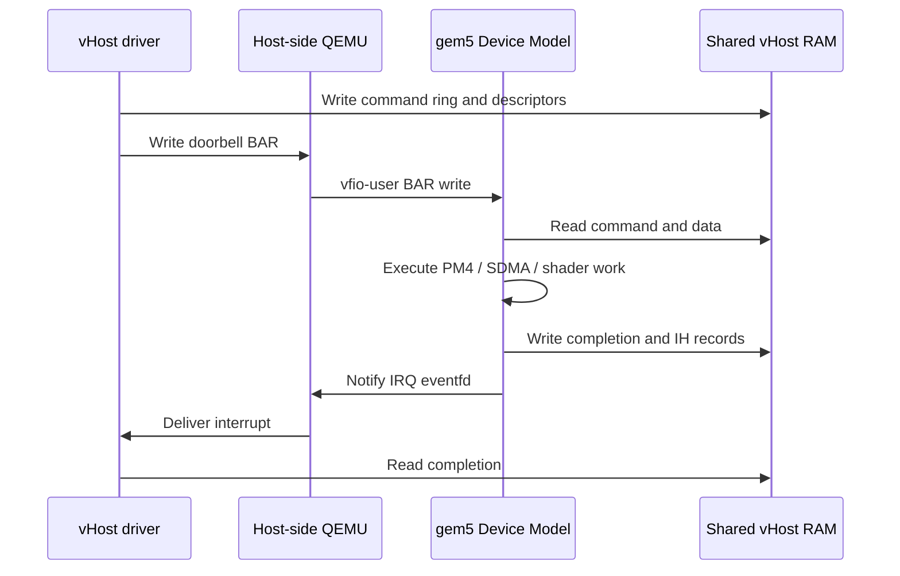

[中文](../zh/architecture.md)

# Co-simulation architecture

## Terms

**Host** is the operating-system environment that runs the Rust launcher,
Host-side QEMU and Device Model processes. **vHost** is the virtual host
environment created by QEMU with KVM or TCG. A **Device Model** is an
independent gem5 or QEMU process that represents a vGPU/vGPGPU target and
connects to the Host-side QEMU vfio-user endpoint through libvfio-user.

The YAML `host` key and Rust `Host` type configure Host-side QEMU and the
virtual hardware presented to the vHost. Existing layout identifiers such as
`guest`, `guest_ranges` and `guest_ram` remain literal interface names; prose
calls the environment vHost.

## Machines and Device Models

The Rust `cosim` executable reads a YAML topology and manages each machine's
Host-side QEMU process, Device Model processes, shared memory and disk
overlays. A Device Model uses gem5 or QEMU and runs as a native process on the
Host, which can be Linux or the development container. Every Device Model
connects to its machine's Host-side QEMU through a separate vfio-user Unix
socket. Each machine owns one memory pool.

`cosim-topology` owns document parsing, validation, template expansion, memory
layout and argument rendering; it reads nothing but the YAML documents.
`cosim-runtime` owns planning against the local system, execution and cleanup.
`cosim-cli` exposes those operations as commands. The
[topology reference](topology.md) defines fields and lifecycle behavior.

Host-side QEMU runs the vHost Linux OS, the amdgpu driver and ROCm applications.
gem5 runs the MI300X command processors, Shader/CU arrays, SDMA engines and Ruby memory
hierarchy. Its cosimulation configuration uses `StubWorkload` with device-only
execution. A QEMU Device Model process uses `x-remote` and
`x-vfio-user-server` to export its PCI device. Host-side QEMU and the Device
Model QEMU process have independent command lines and lifetimes.

Each process runs in its own process group and starts through
`setpriv --pdeathsig KILL`. A Device Model must pass its readiness probes before
Host-side QEMU starts; QEMU then negotiates QMP capabilities and optionally
waits for a configured vHost serial message. Host-side QEMU stops before its
Device Models.

## Rust modules and interfaces

The workspace has three crates. `cosim-cli` depends on `cosim-topology` and
`cosim-runtime`; the runtime depends on the topology crate.

- `cosim-cli/src/main.rs`: Clap commands `validate`, `graph`, `schema`, `run`
  and `clean`; `run --dry-run` inspects image cache state and prints the plan;
  the normal run path builds or reuses the recipe before launching.
- `cosim-topology/src/raw.rs`, `model.rs`, `size.rs`: decoded input types,
  validated types (`Topology`, `Machine`, `Host`, `Device`, `Disk`) and
  `ByteSize`.
- `cosim-topology/src/loader.rs`, `resolve.rs`: imports, merge keys, template
  inheritance, workspace-relative resource paths, count expansion and validation.
- `cosim-topology/src/adapter/`: the `Adapter` enum with the `gem5-mi300x`,
  `qemu-device` and template adapters, vHost QEMU rendering and `Probe`.
- `cosim-topology/src/layout.rs`: memory pools and vHost physical ranges for a
  given `PageSize`.
- `cosim-runtime/src/env.rs`, `layout.rs`, `plan.rs`: `ExecEnv`,
  `SessionLayout` and the serializable `Plan`.
- `cosim-runtime/src/session.rs`, `node.rs`, `probe.rs`: session resources,
  node type states, dependency leases, readiness probes and the verdict.
- `cosim-runtime/src/process.rs`, `resource.rs`, `disk.rs`: process groups,
  file and lock owners, image creation, leases and overlays.
- `cosim-runtime/src/manifest.rs`, `assets.rs`: `cosim clean` after launcher
  death or an abnormal exit, and local input checks.
- `cosim-runtime/src/images.rs`: invokes the shared recipe manager and turns
  its verified disk and optional kernel artifacts into payload inputs.
- `resources/images/`: shared Packer/QEMU template, image builder and
  OS-specific recipe data. `scripts/host/cosim-image` exposes the same manager to
  Bash callers without starting the simulator.

The topology API exposes `load`, `graph` and `schema`, and the validated types
render launch arguments from `DeviceContext` and `HostContext`. The runtime API
exposes `plan`, `run`, `clean`, `check_assets`, `RunOptions`, `Shutdown` and
`Event`. A plan records executables, arguments, environments, dependencies,
readiness probes, shared-memory regions, disk targets and lock paths.

YAML syntax and merge keys use `serde_yaml_ng`; typed decoding uses Serde.
MiniJinja renders argument templates, Schemars produces JSON Schema, and
`parse-size` handles size expressions. Tokio runs the session on one thread,
`futures-util` drives the process nodes concurrently, and `nix` provides
process-group signals, page size and filesystem statistics. Project Rust crates
inherit `unsafe_code = "forbid"` from the workspace.

The Host architecture selects the runnable QEMU binary. The YAML `host` block
and Host templates such as `host-x86` and `host-arm` configure Host-side QEMU and the
virtual hardware presented to the vHost. Planning derives shared-file offsets
and connection paths from those values. gem5 and QEMU exchange vfio-user
traffic directly. Rust negotiates QMP for readiness and manages process
resources. Switch nodes are a reserved part of the design; remote placement is
described by configuration and rejected by the local executor before allocation.

## vfio-user interface

Host-side QEMU's `vfio-user-pci` is the vfio-user client. gem5's
`MI300XVfioUser` uses libvfio-user to expose configuration space, BARs, DMA
mappings and interrupts. QEMU Device Models export the same protocol through
`x-vfio-user-server`.

| Operation | Interface |
|---|---|
| PCI configuration and MMIO | vfio-user messages |
| Doorbell access | Device BAR callbacks |
| vHost RAM sharing | DMA_MAP with a file descriptor and file offset |
| Mappable BAR regions | Region file descriptor and mmap offset |
| MSI-X delivery | IRQ eventfd registration and notification |

Unix sockets and shared-file mappings require colocated Host-side QEMU and
Device Model processes. Device Model implementations determine PCIe peer access,
inter-device communication and simulated timing. The runtime manages process
connections and resources.

## MI300X PCI interface

MI300X identifies as vendor `0x1002`, device `0x74a0`. The Device Model owns
the PCI configuration space and advertises its BAR layout to QEMU.

| BAR | Contents | Size and representation |
|---|---|---|
| 0 + 1 | VRAM | Configurable power-of-two size; 64-bit prefetchable |
| 2 + 3 | Doorbells | 4 MiB; 64-bit BAR |
| 4 | MSI-X | 256 vectors |
| 5 | MMIO registers | 512 KiB; 32-bit BAR |

The driver expects VRAM at BAR0, doorbells at BAR2 and MMIO at BAR5. The upper
halves of 64-bit BARs participate in size probing. Capabilities are registered
before the vfio-user context is realized. The vHost's ROM and driver setup are
provided by `cosim-gpu-setup.service`.

## Shared memory

The launcher computes each machine's pool before starting processes. vHost RAM
occupies the first region; device regions follow with explicit alignment.
Every region has a name, offset and size recorded in `layout.json`.

These regions are slices of one file. QEMU's `memory-backend-file` maps the
vHost RAM region with `share=on`. gem5 receives the pool path and VRAM offset.
Its `PhysicalMemory` maps vHost RAM and device memory at the assigned offsets,
checks the assigned size and leaves the external file's length unchanged.
`MI300XVfioUser` registers the same VRAM file offset with `vfu_setup_region`,
so QEMU and gem5 access identical bytes through the BAR mapping.

The launcher reserves every pool's storage before starting any simulator.
Concurrent sessions therefore consume the filesystem's available capacity
during preparation. A failed reservation releases that session's resources.
The launcher creates and removes pool files. Device processes unmap their
views and close descriptors. The POSIX shared-memory parameters used by the
shell launch interface remain available for that interface.

vHost RAM includes command rings, fences, interrupt records, queue descriptors
and DMA buffers. VRAM includes device allocations, discovery data and GPU
page tables. A common backing file gives both simulators access to the data;
device ordering, caches and vHost software still determine synchronization.

### vHost physical address layout

QEMU templates define `memory_map` as physical RAM ranges. Rust validates
their ordering, alignment and total size, assigns packed file offsets, and passes
the resolved JSON to gem5 through `--host-memory-ranges`.

| QEMU Host configuration and vHost address range | Pool file offset |
|---|---|
| Q35: `[0, below_4g)` | Starts at zero |
| Q35: `[4 GiB, 4 GiB + above_4g)` | Starts at `below_4g` |
| AArch64 virt: `[1 GiB, 1 GiB + ram_size)` | Starts at zero |

The vHost PCI hole consumes no bytes in the pool. VRAM regions begin after
the complete vHost RAM region. vHost physical addresses and file offsets are
separate fields. ARM64 hardware uses `qemu-system-aarch64`; x86_64 hardware uses
`qemu-system-x86_64`. The gem5 `VEGA_X86` model configuration can be compiled for
either native Linux execution architecture.

## GPU address translation

`AMDGPUVM` provides AGP, GART, MMHUB and user-context translation. The driver
programs aperture registers and page-table bases through MMIO.

| Address class | Translation |
|---|---|
| AGP | `physical = virtual - agpBot + agpBase` |
| VMID 0 GART | Single-level GPU page table |
| Framebuffer | Device-relative VRAM offset |
| MMHUB | VRAM aperture offset |
| VMID greater than zero | Context-specific multi-level page-table walk |

Relevant register state includes `fbBase`, `fbTop`, `fbOffset`, `agpBase`,
`agpBot`, `agpTop`, `sysAddrL`, `sysAddrH`, `ptBase`, `ptStart` and `ptEnd`.
Their storage and register conversions are implemented in
`third_party/gem5/src/dev/amdgpu/amdgpu_vm.cc`.

GART entries occupy eight bytes each. The table offset for a GPU page is
derived from the page index relative to the aperture. PM4 and SDMA use
`getGARTAddr()` where their translation interface requires the encoded table
address. Physical page bits and the original page offset determine the
translated physical address.

The vHost OS can update page tables through QEMU's mapped VRAM BAR. gem5's
cosimulation translation path reads the shared VRAM mapping, including
normalization of framebuffer-relative page-table bases. User-context walks
use `VegaISA::Walker` and the model's TLB invalidation handling. The runtime
preserves mapping offsets and sizes; address classification and page faults
remain in the GPU model.

## Commands, DMA and interrupts

PM4 and SDMA select their device-memory or system-memory paths according to
the address and VM context. System-memory operations use the shared vHost
RAM backing. Device-memory operations use the GPU memory manager and the
assigned VRAM backing. The shared file provides storage for the memory model;
Ruby and the GPU components retain their own request and cache behavior.

The interrupt handler writes an IH record, updates its write pointer and
then requests an interrupt. `AMDGPUDevice::intrPost()` reaches
`MI300XVfioUser`, which triggers the configured IRQ eventfd. With KVM, the
registered eventfd supports interrupt injection into the vHost. IH records
and completion values remain accessible through shared vHost RAM.

## Device Model interconnects

gem5's `XGMIBridge` and related configuration implement simulator-specific
interconnect behavior. The Python configuration also supports a separate
multi-GPU gem5 process mode through `--num-gpus`; that mode creates its GPU
objects and interconnects inside gem5. The YAML MI300X adapter starts one GPU
per process and assigns one VRAM region to it.

`configs/sst/multi_node_topology.py` describes SST network parameters.
`configs/sst/mi300x_merlin_poc.py` contains an SST integration experiment.
These configurations require their respective simulator components and are
independent of the Rust process-management interface.

## Source interfaces

| File or directory | Responsibility |
|---|---|
| `crates/cosim-topology/src/` | YAML documents, validated types, memory layouts and adapters |
| `crates/cosim-runtime/src/` | Plans, process supervision, resource ownership and cleanup |
| `third_party/gem5/configs/example/gpufs/mi300_cosim.py` | MI300X objects and pool parameters |
| `third_party/gem5/src/mem/physical.{cc,hh}` | Physical memory backing and bounds |
| `third_party/gem5/src/dev/amdgpu/mi300x_vfio_user.{cc,hh}` | BAR/configuration/IRQ protocol handling |
| `third_party/gem5/src/dev/amdgpu/amdgpu_vm.{cc,hh}` | Address translation |
| `third_party/gem5/src/dev/amdgpu/pm4_packet_processor.{cc,hh}` | PM4 command processing |
| `third_party/gem5/src/dev/amdgpu/sdma_engine.{cc,hh}` | SDMA execution |
| `third_party/gem5/src/dev/amdgpu/interrupt_handler.cc` | IH records and interrupts |
| `third_party/qemu/hw/remote/vfio-user-obj.c` | QEMU device-server interface |
