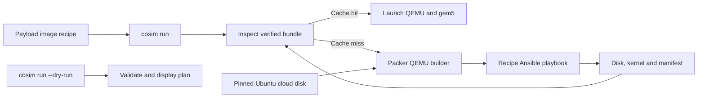

[中文](../zh/rocm-image.md)

<!--
SPDX-License-Identifier: Apache-2.0
-->

# vHost Image Recipes

vHost OS image recipes live in `resources/images/recipes/`, organized by
distribution, release, architecture and software recipe. The first recipe is
`ubuntu/24.04/x86_64/rocm7_0`. The runtime payload example that selects it
is `samples/payloads/ubuntu-rocm7_0.yaml`; runtime payload examples belong in
`samples/payloads/`. A recipe describes image construction and its output
artifacts, while the machine topology describes hardware.



The recipe starts from Ubuntu 24.04's [2026-08-26 cloud image release](https://cloud-images.ubuntu.com/releases/noble/release-20260826/).
Its SHA-256 is stored in `recipe.toml`. Packer's [QEMU builder](https://developer.hashicorp.com/packer/integrations/hashicorp/qemu/latest/components/builder/qemu)
sets `disk_image = true`, creates a standalone QCOW2 image, and boots it with
QEMU. The image builder generates a temporary SSH keypair before starting
Packer, passes the public key through cloud-init, and uses the matching private
key for the SSH communicator. The Packer [Ansible
provisioner](https://developer.hashicorp.com/packer/integrations/hashicorp/ansible/latest/components/provisioner/ansible)
installs the
selected kernel packages, the pinned AMDGPU DKMS package
`1:6.14.14.30100000-2204008.24.04`, ROCm, PyTorch and cosim services, builds
the gem5 WMI module, and exports the matching kernel and package inventory.
When DKMS fails, the image build prints its `make.log` files. The shared Packer
QEMU builder is in `resources/images/packer/`. The recipe contains its OS and
package data, its Ansible playbook and the files installed into the vHost.

The ROCm recipe keeps its guest scripts and WMI source in its recipe directory.
Its ROM and discovery firmware inputs come from the pinned
`third_party/gem5-resources` submodule, which also supplies GPU application
sources. The recipe and shared Packer template are maintained
in this repository. The `gem5` submodule builds the `m5` utility and simulator,
and the `qemu` submodule provides the QEMU build used by co-simulation.

## Build and inspect

Image construction requires Linux x86_64, `/dev/kvm`, QEMU, `qemu-img`,
`readelf`, `ssh-keygen` from `openssh-client`, Python 3 with `venv`, and enough
free disk space for the 56 GB vHost OS disk. The image command downloads pinned
Packer 1.16.1 and installs pinned
Ansible Core 2.18.6 under `build/tools/`. Packer downloads and plugins are kept
under `build/cache/`; logs, temporary files and final image artifacts stay
under `build/`.

Build and verify the ROCm recipe with:

```bash
just build-rocm-assets
just test-rocm-assets
```

The Host-side Bash entry `scripts/host/cosim-image` supports listing, validating,
building and verifying recipes without the simulator launcher. `cosim run --dry-run`
validates the selected recipe and topology, reports the resolved commands and
whether it would build or reuse the image, and exits without writing files or
starting QEMU or gem5. A normal `cosim run` builds on a cache miss, verifies the
bundle, then validates its kernel and disk before launching.

The verified bundle is stored under
`build/images/ubuntu/24.04/x86_64/rocm7_0/`. It contains `disk`, the
matching `kernel`, package inventories, build logs and `manifest.json`. The
manifest records the pinned base image, recipe files, declared external
firmware and `m5` inputs, QEMU and QEMU image tool versions, Packer and Ansible versions,
and SHA-256 values for each artifact. QCOW2 bundles must pass `qemu-img check`
and must not depend on a backing file. A recipe or input change creates a new
input identity; a matching verified bundle is reused.

## CI evidence

The image job builds `m5`, validates the Packer and Ansible configuration,
checks for a retained bundle with the same input identity, and builds only when
no valid bundle is available. It publishes the disk, kernel and manifest as a
workflow artifact. The integration job downloads and verifies that bundle,
then runs the ROCm vHost regression through the Rust launcher. The gem5 binary
uses its separate build cache. Image and simulator inputs are verified before
the vHost starts; the workload results and build diagnostics are retained as
CI artifacts.
