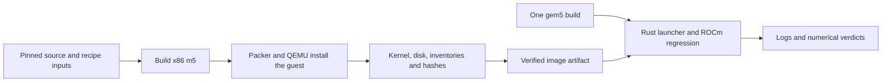

[中文](../zh/rocm-image.md)

<!--
SPDX-License-Identifier: Apache-2.0
-->

# ROCm image construction

The image builder uses the selected `gem5-resources` recipe at
`src/x86-ubuntu-gpu-ml`. Packer starts a real QEMU/KVM virtual machine, installs
Ubuntu and ROCm, then exports the disk and its matching Linux kernel. gem5's
[official GPUFS instructions](https://www.gem5.org/documentation/general_docs/gpu_models/gpufs)
require this disk/kernel pairing because the GPU driver is built for that kernel.



The recipe selects Ubuntu 24.04.2, ROCm 7.0 and Linux 6.8.0-124-generic.
One Packer kernel selection controls Ubuntu installation, its first boot,
headers, DKMS compilation and kernel export. Failed provisioning preserves
the complete DKMS build logs in the Packer output.
It installs the complete `rocm` package, amdgpu DKMS, PyTorch from the selected
ROCm 6.0 wheel channel, ROM/discovery data, root serial autologin and
`cosim-gpu-setup.service`. The installer checks the DKMS module path and kernel
version, and validates the service unit. Packer 1.16.1 and its QEMU plugin 1.1.7
are pinned. The Ubuntu ISO and Packer download are checksum-verified.

## Local construction

Use a Linux x86_64 host with accessible `/dev/kvm`, at least 60 GiB of free
storage for construction and compression, and enough memory for an 8 GiB build
VM. Install QEMU, qemu-img, curl, unzip, Perl's shasum, binutils, SCons and a C++
compiler. The host needs access to Canonical, AMD, HashiCorp and PyTorch package
services. The native image build entry point is:

```bash
COSIM_ENV=host just build-rocm-assets
COSIM_ENV=host just test-rocm-assets
```

This entry builds m5 from the selected gem5 revision, stages the tracked recipe
files, invokes its `build.sh`, and publishes the bundle after integrity checks.
An output directory belongs to one exact input identity. Different inputs use
different output directories. Matching completed outputs are verified and reused.

`just build-disk` creates a raw bundle at `build/rocm-local` and installs
separate copies under `build/rocm-local-installed` for the standard samples. The
local disk remains writable for the legacy launcher; the reusable bundle keeps
its original contents. Filesystems that support reflinks share the initial
storage; other filesystems need additional room for the installed copy.
Existing local files are preserved. `just check-rocm-image <new-directory>`
builds m5 and validates the complete configuration with real Packer plugins.
`just check-rocm-syntax <new-directory>` checks HCL syntax on any supported
Packer host.

## Bundle and reuse

The bundle contains `kernel`, `disk`, `manifest.json`, `kernel-release`,
`image-packages.tsv`, `python-packages.json`, `amdgpu-module.txt`,
`hipcc-version.txt`, `os-release`, and the complete Packer/build logs. The
manifest records source and input identities, build time, resolved versions
and SHA-256 values. QCOW2 images must pass `qemu-img check` and have no backing
file; raw images use paired hashes and image information. The regression uses
a fresh disk overlay for every workload.

The cache identifies the selected build recipe and its completed output.
The input record includes one SHA-256 digest of all inherited `PKR_VAR_*`
overrides, including `PKR_VAR_kernel_release`, and the selected image basename.
`PKR_VAR_image_name` may select another basename; the bundle publishes it as
`disk`. The CI image producer exercises this with `cosim-rocm-ci`.
Package servers remain live inputs. The package inventories record what was
installed; changing `COSIM_ROCM_IMAGE_EPOCH` requests fresh dependency resolution.

CI runs the image producer alongside the single gem5 producer. It finds retained
image artifacts from the same source repository and branch, reads their paired
metadata artifacts, and requires the exact input fingerprint. The producer
downloads and verifies the selected image, then publishes a fresh artifact for
the current workflow. A missing or expired metadata artifact is skipped; an
unavailable image download triggers automatic construction. Corrupt completed
downloads fail verification. The regression receives the two current immutable
artifact IDs and checks the requested image inputs and every product before
boot. Image artifacts are retained for two
days; complete diagnostic logs are retained for fourteen days.

The complete image uses artifact storage. The measured compressed image exceeds
GitHub's [default 10 GB repository cache limit](https://docs.github.com/en/actions/reference/workflows-and-actions/dependency-caching#usage-limits-and-eviction-policy).
The gem5 bundle uses the build cache independently. The final gate requires all
producers and the actual guest workload job to pass.
Build workflows run serially for each Git ref. An update queues the latest
pending revision while the current workflow continues, allowing successful
producers to publish reusable assets for that revision.

The gem5 producer also caches its binary, static library and complete build
image together. Its key covers gem5, the relevant just recipes and settings,
the build job, helper scripts and Dockerfile. Cache hits preserve the original
`build_source` and `build_run`; the current producer records its own revision
and run identity separately. `COSIM_GEM5_CACHE_EPOCH` requests a fresh toolchain
build. Image-recipe changes can reuse the matching simulator artifact.

## Execution evidence

Image construction establishes the installed files and paired module/kernel
identity. The guest job establishes boot, amdgpu/KFD/render-device readiness,
gfx942 discovery through `rocminfo`, HIP compilation, numerical verification and
successful process exits. Both forms of evidence are retained in CI artifacts.
