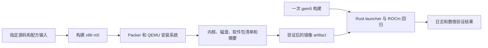

[English](../en/rocm-image.md)

<!--
SPDX-License-Identifier: Apache-2.0
-->

# ROCm 镜像构建

镜像构建使用指定版本 `gem5-resources` 的 `src/x86-ubuntu-gpu-ml` 配方。
Packer 启动真实的 QEMU/KVM 虚拟机，安装 Ubuntu 和 ROCm，再导出磁盘与配套
Linux 内核。gem5 的[官方 GPUFS 文档](https://www.gem5.org/documentation/general_docs/gpu_models/gpufs)
要求将导出的内核与对应磁盘一起使用，因为 GPU 驱动针对该内核构建。



配方选择 Ubuntu 24.04.2、ROCm 7.0 和 Linux 6.8.0-124-generic，安装完整
`rocm` 软件包、amdgpu DKMS、指定 ROCm 6.0 wheel 源中的 PyTorch、ROM 与
discovery 数据、root 串口自动登录及 `cosim-gpu-setup.service`。
安装程序检查 DKMS 模块路径与内核版本，并验证服务单元。Packer 固定为 1.16.1，
QEMU 插件固定为 1.1.7。Ubuntu ISO 和 Packer 下载均检查文件摘要。
Packer 中同一个内核版本配置用于 Ubuntu 安装、首次启动、头文件、DKMS 编译和
内核导出。安装失败时，完整的 DKMS 编译日志保留在 Packer 输出中。

## 本地构建

构建需要 Linux x86_64 host、可访问的 `/dev/kvm`、至少 60 GiB 可用磁盘空间，
以及运行 8 GiB 构建虚拟机所需的内存。host 需要安装 QEMU、qemu-img、curl、
unzip、Perl 的 shasum、binutils、SCons 和 C++ 编译器，并能够访问 Canonical、
AMD、HashiCorp 和 PyTorch 的软件服务。原生构建入口为：

```bash
COSIM_ENV=host just build-rocm-assets artifacts/rocm-assets
COSIM_ENV=host just test-rocm-assets artifacts/rocm-assets
```

这个入口先从指定 gem5 版本构建 m5，再将受版本控制的配方文件复制到构建目录，
调用其 `build.sh`，完成完整性检查后发布产物。每个输出目录对应确定的输入标识；
不同输入使用不同输出目录。输入匹配的完整产物通过验证后可以复用。

`just build-disk` 在 `artifacts/rocm-local` 生成 raw 产物，并在标准示例使用的
磁盘和内核路径安装独立副本。本地磁盘允许旧启动程序写入，可复用产物保留初始内容。
支持 reflink 的文件系统共享初始存储；其他文件系统需要为安装副本提供额外空间。
已有本地文件会保留。
`just check-rocm-image <新目录>` 构建 m5，并使用真实 Packer 插件检查完整配置。
`just check-rocm-syntax <新目录>` 在 Packer 支持的 host 上检查 HCL 语法。

## 产物与复用

产物包含 `kernel`、`disk`、`manifest.json`、`kernel-release`、
`image-packages.tsv`、`python-packages.json`、`amdgpu-module.txt`、
`hipcc-version.txt`、`os-release`，以及完整的 Packer 和构建日志。
清单记录源码与输入标识、构建时间、实际安装版本和 SHA-256。QCOW2 镜像需要通过
`qemu-img check`，并且独立保存全部数据；raw 镜像检查配套文件摘要和镜像信息。
回归程序为每个用例创建独立的磁盘 overlay。

缓存按配方输入查找经过完整性验证的产物。输入记录包含所有继承的 `PKR_VAR_*`
参数的 SHA-256 摘要，包括 `PKR_VAR_kernel_release`，并记录所选磁盘文件名。
`PKR_VAR_image_name` 可以指定其他文件名，产物统一保存为 `disk`。
CI 镜像任务使用 `cosim-rocm-ci` 验证该路径。
软件包服务持续更新；清单记录实际安装的软件包，
修改 `COSIM_ROCM_IMAGE_EPOCH` 可以重新解析依赖。

CI 并行执行镜像任务和单次 gem5 构建任务。镜像任务查找来自相同源码仓库和分支
的已保留 artifact，读取配套元数据，要求输入指纹完全匹配。构建任务下载并验证
选定镜像，再为本轮工作流发布新的 artifact。元数据 artifact 缺失或过期时跳过
该候选；镜像下载不可用时自动构建。已下载完整产物的损坏会使验证失败。回归任务
接收本轮两个固定 artifact ID，启动之前检查请求的镜像输入指纹和全部产物。
镜像 artifact 保留两天，完整诊断日志保留十四天。

完整镜像使用 artifact 存储。实际生成的压缩镜像超过 GitHub
[默认的 10 GB 仓库缓存额度](https://docs.github.com/en/actions/reference/workflows-and-actions/dependency-caching#usage-limits-and-eviction-policy)。
gem5 产物独立使用构建缓存。最终检查要求两个构建任务及实际虚拟机测试都通过。
同一个 Git ref 的 Build 工作流依次执行。更新提交时保留正在运行的工作流，
将最新版本加入等待队列，使成功的构建任务能够发布产物，供等待的版本复用。

gem5 任务还将二进制文件、静态库和完整构建镜像一起缓存。缓存标识包含 gem5、
相关 just 配方与配置、构建任务、辅助脚本和 Dockerfile。命中缓存时保留原始
`build_source` 和 `build_run`，本轮任务的源码版本与运行标识单独记录。
修改 `COSIM_GEM5_CACHE_EPOCH` 可以重新构建工具环境。修改镜像配方时可以
复用输入匹配的模拟器产物。

## 执行证据

镜像构建验证安装文件及模块与内核的配套关系。虚拟机任务验证系统启动、amdgpu、
KFD 和 render 设备状态、`rocminfo` 的 gfx942 识别结果、HIP 编译、数值结果和
进程退出状态。CI 产物同时保留这两类证据。
